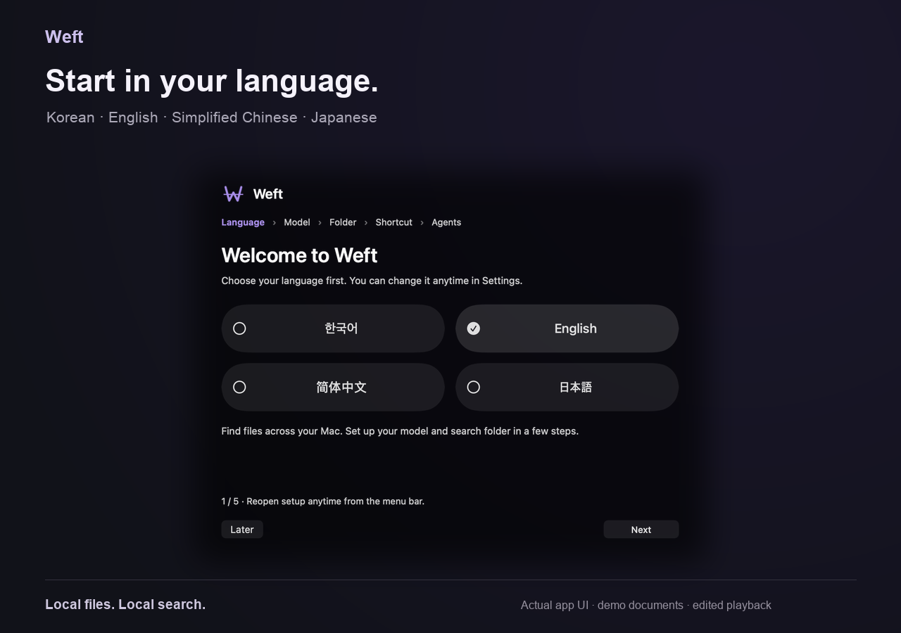
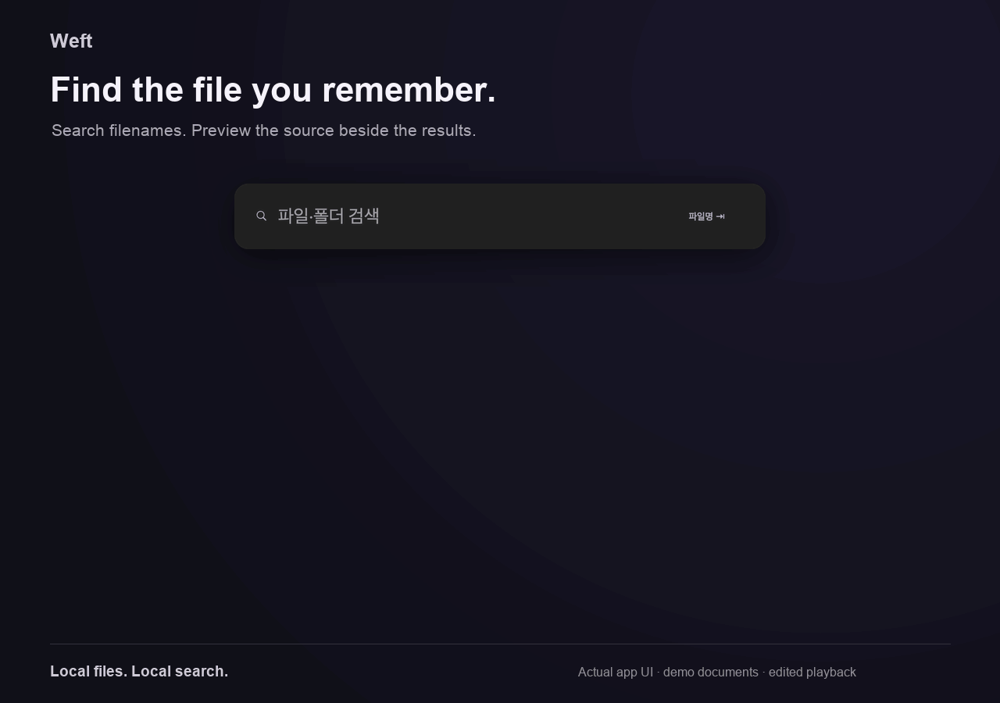

<div align="center">
  
  <h1>Weft</h1>
  <p><strong>파일은 기억나는데, 어디 저장했는지 생각나지 않을 때.</strong></p>
  <p>단축키로 여는 Mac 검색과, 에이전트가 근거를 찾을 수 있는 로컬 파일 탐색.</p>
  <p>
    <a href="README.en.md">English</a> ·
    <a href="https://github.com/CREE1116/weft/releases/latest">최신 릴리스</a> ·
    <a href="docs/TECHNICAL_REFERENCE.md">기술 문서</a>
  </p>
  <p>
    <a href="https://github.com/CREE1116/weft/releases/download/v1.0.2/Weft-1.0.2-arm64.dmg">Apple Silicon 다운로드</a> ·
    <a href="https://github.com/CREE1116/weft/releases/download/v1.0.2/Weft-1.0.2-x86_64.dmg">Intel 다운로드</a>
  </p>
  <p>
    
    
    
    
  </p>
</div>

---

Weft는 **내 파일을 위한 가벼운 검색 앱이자 에이전트용 로컬 검색 엔진**입니다. 파일명만 외우지 않아도 의미로 찾고, 검색 결과에서 원문 위치와 검증된 문맥을 확인할 수 있습니다. 검색과 임베딩은 기기 안에서 실행됩니다.

## 내 언어로 시작하기

첫 시작 화면에서 **한국어·English·简体中文·日本語**를 고릅니다. 안내 화면과 검색·메뉴·설정에 적용되며, 설정 → 일반 → 언어에서 바로 바꿀 수 있습니다. UI 언어를 바꿔도 문서를 다시 색인할 필요는 없습니다.



## 검색 흐름 미리보기



파일명으로 찾고, 기억나는 내용으로 좁히고, `INV-2041` 같은 식별자를 본문에서 바로 조회합니다. 실제 앱 UI와 임시 데모 문서의 검색 결과로 만든 편집 데모이며, GIF 재생 시간은 응답 속도를 나타내지 않습니다. [정지 화면](docs/assets/weft-demo-poster.png)

## Weft로 할 수 있는 일

- **Mac에서 바로 찾기** — `⌥ Space`를 눌러 검색하고, 파일명 또는 의미 검색을 전환합니다. 방향키로 결과를 살펴보고 Quick Look이나 Finder에서 확인합니다.
- **파일이 바뀌면 따라가기** — 선택한 폴더를 백그라운드로 색인하고 변경을 감시합니다. 기본 작업 예산은 25%이며, 검색 요청이 오면 색인이 양보합니다. 메뉴 막대에서 진행·추정 잔여량·감시 상태·오류를 확인합니다.
- **문서 내용까지 검색** — PDF, Word, PowerPoint, Excel, OpenDocument, EPUB, HWPX와 일반 텍스트를 인덱싱합니다. 일반 내용 검색은 의미·본문 키워드·경로를 함께 사용합니다.
- **정확한 이름과 관련도 구분** — `md`·`pdf`는 확장자로 조회하고, 본문에 일치하는 식별자는 추론을 생략합니다. 관련도가 낮거나 1위 점수의 절반에 못 미치는 일반 검색 결과는 숨깁니다.
- **문서를 중앙에서 미리보기** — Word·PDF·Office 문서는 작은 미리보기에서 페이지 전체를 중앙에 맞춰 보여줍니다. `⌘Y`로 큰 미리보기를 열 수 있습니다. [미리보기 예시](docs/assets/weft-document-preview.png)
- **필요한 동작을 키보드로 실행** — `@설정`, `@메모`, `@녹음`, `@web`과 파일·폴더 검색 범위를 사용합니다. 자주 쓰는 앱이나 URL도 별칭으로 연결할 수 있습니다.
- **에이전트가 근거를 찾기** — Codex와 Claude Code 등에 Weft 스킬을 설치해 폴더 탐색, 파일 선택, 원문 문맥 확인을 맡길 수 있습니다.
- **음성 메모와 Markdown 메모** — 다국어 음성을 기기에서 전사하고, Markdown 메모를 로컬에 저장해 검색합니다.

| 찾고 싶은 것 | 입력 예시 | 동작 |
| --- | --- | --- |
| 파일 이름·형식 | 파일명 모드에서 `보고서`, 내용 모드에서 `md` | 경로·파일명 또는 정확한 확장자로 조회 |
| 기억나는 문서 내용 | `청구서 승인`, `데이터베이스 재시도 정책` | 의미와 본문 키워드를 결합하고 약한 결과를 제거 |
| 식별자·코드 심볼 | `INV-2041`, `retryHandler` | 본문 키워드가 완전히 일치하면 추론 없이 조회 |
| 조건을 조합한 근거 | `데이터베이스 + 재시도 - 여행` | 명시적인 의미 조건과 부정 조건을 유지 |

의미 검색은 다국어 모델을 사용하며, 영어·프랑스어·스페인어·독일어·러시아어·아랍어·일본어·중국어의 기본 동작을 확인했습니다. 이는 언어별 정확도 평가가 아닙니다. 한국어 본문 부분 검색을 지원하며, 일본어·중국어의 문장 중간 부분 키워드 검색은 아직 보강이 필요합니다. [검증 기록](eval/MULTILINGUAL_SEMANTIC_2026-10-15.json)

## 다운로드 및 시작

### macOS 앱

1. 위에서 Mac에 맞는 DMG를 내려받아 `Weft.app`을 Applications 폴더로 옮깁니다.
2. 앱을 열고 UI 언어를 먼저 고른 뒤 모델·검색 폴더·전역 단축키를 준비합니다.
3. 메뉴 막대의 Weft 아이콘에서 인덱싱을 시작하거나 변경 감시를 켭니다.
4. `⌥ Space`를 눌러 검색합니다.

macOS 14 이상을 지원합니다. Apple Silicon과 Intel용 앱을 각각 제공합니다. 공개 빌드는 Developer ID 공증 정보 없이 만들어질 수 있으며, Gatekeeper가 막으면 **시스템 설정 → 개인정보 보호 및 보안 → 그래도 열기**를 사용하세요.

### CLI 및 에이전트 스킬

저장소를 내려받은 뒤, 모델과 CLI 및 에이전트 스킬을 준비합니다. 아래 명령은 자동 인덱싱을 시작하지 않습니다.

```sh
git clone https://github.com/CREE1116/weft.git
cd weft
./scripts/install.sh --no-index
```

```sh
weft search "데이터베이스 재시도 정책" --json
weft index ~/Documents --watch
weft stats --json
```

`@settings`, `@note`, `@record`도 기존 한글 명령과 같은 동작을 합니다. CLI 검색은 `--min-similarity 0.3 --weak-ratio 0.5`로 관련도 기준을 조절할 수 있습니다. 형식·식별자 조회는 정확한 키워드 근거를 유지합니다.

검색용 텍스트 모델은 최초 설정 시 내려받습니다. 에이전트 스킬은 `.agents/skills/weft-semantic-search`에 포함돼 있으며, 설치 위치를 직접 선택할 수도 있습니다. 더 자세한 설치와 CLI 사용법은 [기술 참조](docs/TECHNICAL_REFERENCE.md)를 확인하세요.

## 개인정보와 인덱싱

- 기본 검색과 임베딩은 로컬에서 실행되며, 검색어와 파일 내용은 검색 서비스로 전송되지 않습니다.
- 인덱스에는 경로, 파일 해시, 위치 정보와 벡터를 저장합니다. 원본 문서 전체를 복사해 저장하지 않습니다. 본문 키워드 검색용 토큰 역색인은 디스크에 남으므로 인덱스도 개인 데이터로 관리해야 합니다.
- 앱은 온보딩만으로 전체 디스크를 스캔하지 않습니다. 사용자가 선택한 폴더에서 인덱싱을 시작하고, 설정에서 감시·수동 갱신·제외 형식과 인덱스 삭제를 관리합니다.
- 모델 최초 다운로드, GitHub 업데이트 확인, 사용자가 선택한 웹 검색은 네트워크를 사용할 수 있습니다. 미디어 임베딩과 음성 모델은 선택 기능이며 필요할 때 별도로 준비합니다.

## 지원 파일

| 종류 | 인덱싱 내용 |
| --- | --- |
| 소스 코드, Markdown, 텍스트, 설정 파일, 노트북 등 | 파일명과 문서 내용, 문맥 청크 |
| PDF, DOCX/DOCM, PPTX/PPTM, XLSX/XLSM | 추출 가능한 텍스트와 위치 정보 |
| ODT/ODP/ODS, EPUB, HWPX | 추출 가능한 텍스트 |
| 그 외 파일 및 지원 한도를 넘는 파일 | 파일명·경로 기반 검색 |
| 이미지·오디오·비디오 | 선택형 미디어 모델을 준비한 경우 내용 임베딩 |

문서 파싱 한도와 형식별 제약, 이미지·오디오 전사 조건은 [기술 참조](docs/TECHNICAL_REFERENCE.md)에 정리했습니다. 파일명 검색은 파일 내용을 색인하지 않은 결과일 수 있으며, Weft는 이를 구분해 표시합니다.

## 벤치마크

### 검색 정확도와 결과 선택 — 2026-10-15

Apple M4 Pro, Metal, 768차원 Q8 인덱스에서 **26개 파일·21개 평가 질의**를 비교했습니다. 검색 시간은 질의당 7회 측정한 따뜻한 검색 단계이며, **모델 로딩·임베딩 추론·프로세스 시작은 제외**합니다. 작은 개발 평가셋이므로 일반적인 검색 정확도나 대규모 인덱스 성능을 보장하지 않습니다.

| 검색 방식 | Recall@10 | MRR@10 | NDCG@10 | 검색 p50 | 검색 p95 |
| --- | ---: | ---: | ---: | ---: | ---: | ---: |
| 의미 검색 | 1.000 | 0.913 | 0.935 | 0.034 ms | 0.044 ms |
| 기존 의미+경로 RRF | 1.000 | 0.913 | 0.935 | 0.047 ms | 0.059 ms |
| 본문 키워드+의미 결합 · 컷오프 | 1.000 | 0.976 | 0.982 | 0.431 ms | 0.669 ms |

MRR·NDCG는 정답이 결과 목록 앞쪽에 있는지를 평가하며 클수록 좋습니다. 이 평가셋에서는 새 결합의 정답 순위가 개선됐습니다. 기존 RRF의 결과 선택 단계는 더 저렴하며, 새 결합에는 본문 키워드 조회 비용이 추가됩니다. [전체 비교·측정 조건·재현 방법](eval/HYBRID_SEARCH_2026-10-15.md) · [원시 결과](eval/HYBRID_SEARCH_2026-10-15.json) 컷오프를 적용한 새 결합은 질의당 평균 1.57개 결과를 표시했고, 이 평가셋에서 정답 누락은 없었습니다. [컷오프 포함 결과](eval/HYBRID_SEARCH_CUTOFF_2026-10-15.json)

### 모델 로딩과 대규모 벡터 검색 — 2026-10-12

같은 Apple M4 Pro에서 **32,636개 파일·89,894개 청크**의 동일 인덱스 스냅샷으로 이전·최적화 빌드를 번갈아 7회 실행했습니다. 아래 값은 중앙값입니다. 위의 작은 검색 평가와는 데이터·빌드·측정 단계가 다르므로 시간을 직접 비교할 수 없습니다.

| 측정 항목 | 이전 빌드 | 최적화 빌드 | 변화 |
| --- | ---: | ---: | ---: |
| 모델 로딩 | 324.096 ms | 176.155 ms | **45.6% 단축** |
| mmap SIMD 검색 + Top-K | 8.217 ms | 3.701 ms | **55.0% 단축** |
| 단일 텍스트 WQL 검색 | 22.002 ms | 16.813 ms | **23.6% 단축** |
| 최대 프로세스 메모리 | 953.609 MiB | 873.109 MiB | **80.500 MiB 감소** |
| 짧은 질의 추론 p50 | 11.458 ms | 11.594 ms | 1.2% 증가 |

mmap 검색 시간에는 모델 추론과 SQL 처리가 포함되지 않습니다. 메모리는 전체 벤치마크 프로세스의 최대 RSS입니다. 색인 처리량·전력 사용량·GPU 사용률은 이 실험에서 측정하지 않았습니다. [전체 결과](eval/M4PRO_PERFORMANCE_2026-10-12.md)

현재 런타임은 GPU에서 정규화한 임베딩을 CPU로 한 번 넘겨 Q8 검색에 사용하고, 벡터 저장 시 전체 벡터를 RAM에 복제하지 않습니다. 긴 문서용 마스크는 실제 길이에 맞춰 보관하고 짧은 질의에서 해제합니다. 백그라운드 25% 설정은 계산 시간 예산이며, GPU 사용률 25%를 보장하는 수치는 아닙니다.

## 프로젝트

- [릴리스 및 변경 기록](https://github.com/CREE1116/weft/releases)
- [기술 참조와 CLI 설명](docs/TECHNICAL_REFERENCE.md)
- [검색 결합 평가](eval/HYBRID_SEARCH_2026-10-15.md) · [대규모 속도 측정](eval/M4PRO_PERFORMANCE_2026-10-12.md)
- [문서 형식 검증](eval/DOCUMENT_RESULTS.md)
- [문제 제보](https://github.com/CREE1116/weft/issues)

Weft는 파일 검색 도구입니다. 의미 검색 결과는 관련 가능성을 순위화하며, 내용의 정확성이나 완전성을 보증하지 않습니다. 중요한 근거는 원본 파일에서 확인하세요.
